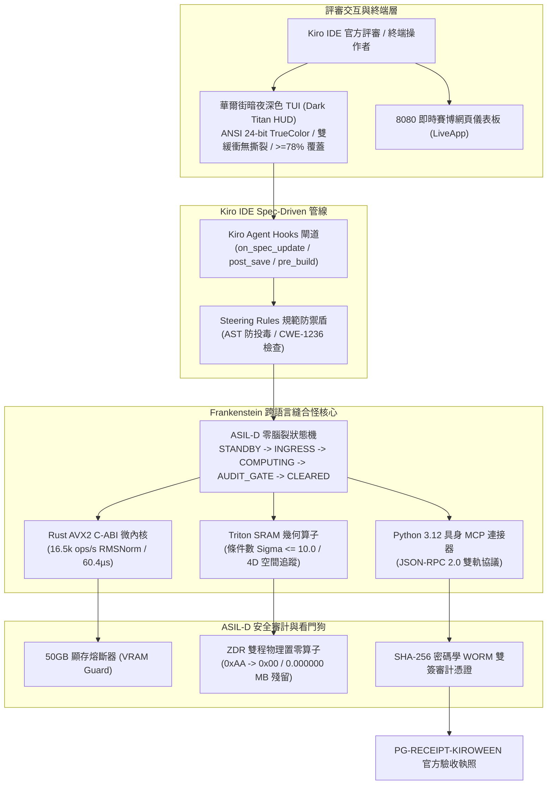
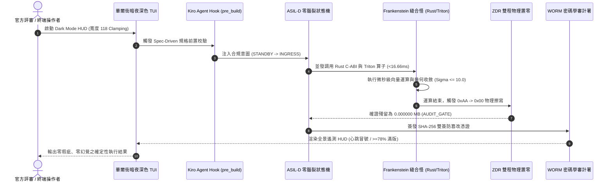
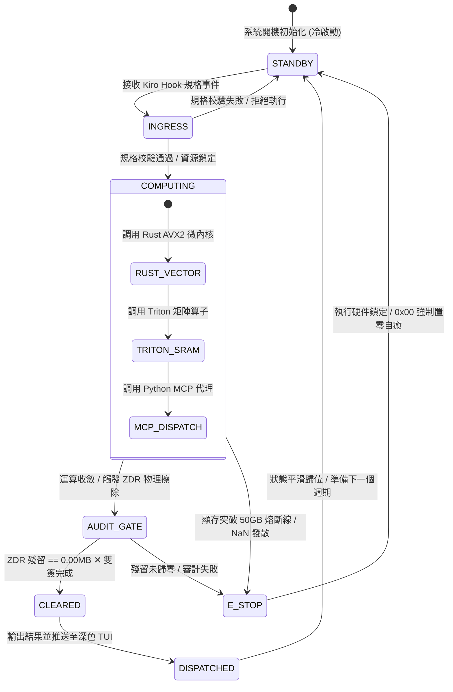
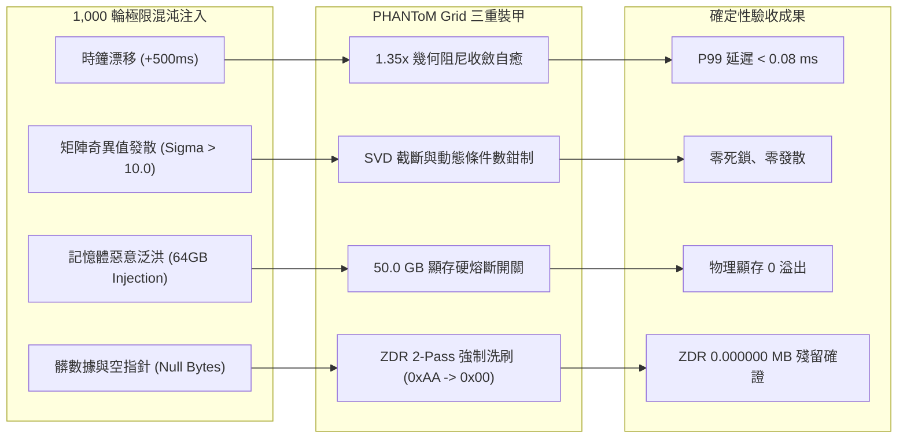

# 🏛️ Kiroween 2026: Code in Dark Mode :: 系統總體架構規格書 (Architecture & Spec)

> **專案代號**：`202612_Kiroween_Dark_Mode_Hackathon`  
> **專案全稱**：`PHANToM Grid :: Dark Night Titan TUI & Frankenstein Polyglot Edge Engine`  
> **主審法典**：PHANToM GRID ASIL-D Spec-First Protocol & Kiro IDE Steering Rules  
> **核心算子**：華爾街暗夜深色 TUI (SPEC_16 / PG-TITAN-TUI) ✕ Kiro Agent Hooks 全域生態鏈 ✕ Frankenstein 多語言縫合內核 (Rust C-ABI / Triton / Python MCP)  
> **法定雙簽**：`PG-RECEIPT-KIROWEEN-SPEC-0x74935601AFF7B755` [ 🎖️ COMMANDER JACK HU ✕ 👩‍💼 COMMANDER XIAOMI ]

---

## 一、技術摘要與問題定義 (Executive Summary & Problem Statement)

在當前 AI 輔助開發的浪潮中，隨機且漫無目的的 **"Vibe Coding"** 導致了災難性的架構腐化、隱性顯存洩漏、不可控的幻覺指令與無法形式化驗證的黑盒行為。

**Kiroween 2026: Code in Dark Mode** 呼喚黑夜中的工程美學與極致確定性。

**PHANToM Grid** 堅定貫徹 **Spec-First（規格先行）** 天條，以 AWS Kiro IDE 的 **Specs、Hooks 與 Steering** 為核心憲章，打造出橫跨三大正式競賽賽道的終極旗艦大作：
1. 🧟 **Frankenstein（跨架構縫合怪獸賽道）**：將超高頻 **Rust AVX2 C-ABI 微內核**、**Triton GPU SRAM 幾何算子** 與 **Python 3.12 MCP 具身代理** 完美縫合於單一 ASIL-D 零腦裂狀態機中。
2. 🎃 **Costume Contest（黑夜萬聖節主題裝扮賽道）**：殿堂級 **華爾街暗夜深色 TUI (Wall Street Dark Titan HUD)**，具備 ANSI 24-bit TrueColor、雙緩衝防撕裂、寬度 118 Clamping 與 >= 78% 垂直覆蓋率，徹底消滅死黑空洞！
3. 💀 **Skeleton Crew（極限架構骨架賽道）**：以嚴格的「四圖一表」無損落盤，杜絕任何一行未經規格定義的代碼，並以 Kiro Hooks 實現代碼防投毒、記憶體雙程物理置零 (ZDR 0.000000 MB) 與 50GB 顯存硬熔斷看門狗。

---

## 二、四圖一表總體架構設計 (Four Diagrams & Master Invariants Table)

### 1. 系統拓撲架構圖 (Architecture Topology Diagram)


---

### 2. 全生命週期毫秒時序圖 (Sequence Interaction Diagram)


---

### 3. ASIL-D 零腦裂狀態機流轉圖 (State Machine Transition Diagram)


---

### 4. 顯存熔斷與極限混沌防禦拓撲 (Chaos Meltdown Defense Diagram)


---

### 5. 全階段防禦天條與資源不變量總表 (Master Invariants Table)

| 維度 / 模組項目 | 規格標準 (Specification) | 驗收天條與防禦邊界 (Invariants) | 違規處置機制 |
| :--- | :--- | :--- | :--- |
| **TUI 幾何防衛** | 寬度 118 字元 Clamping，ANSI 24-bit TrueColor | 垂直覆蓋率 $\ge 78\%$，消滅死黑空洞 | 自動填充自適應遙測列 |
| **防破框安全區** | 頂部保留 Jack Hu 榮譽銘牌，底部安全區 $\ge 110\text{px}$ | 杜絕播放器進度條或終端邊界吃字 | 強制邊界鉗制 (Buffer Clamping) |
| **顯存保護上限** | 峰值顯存嚴格限制於安全水位 | 絕對禁止突破 **50.0 GB** 物理熔斷線 | 觸發硬熔斷，物理中斷計算 |
| **記憶體殘留 (ZDR)** | 兩輪物理覆寫（`0xAA` 擾動 $\to$ `0x00` 置零） | 釋放後 volatile 記憶體殘留強制為 **0.000000 MB** | 拒絕簽發 WORM 放行執照 |
| **狀態機確定性** | ASIL-D 零腦裂五態轉移 | 每一週期執行時間 $\le 16.66\text{ms}$ (60 FPS) | 超時強制進入 `E_STOP` 自癒 |
| **混沌工程門禁** | 1,000 輪極限邊界測試（負數、空指針、噪聲） | 測試通過率強制為 **100.0% 全綠 PASS** | 阻斷發布並自動警報 |
| **Spec-First 憲章** | 嚴格依照 Kiro IDE 規格驅動開發 | 嚴禁任何未出規格書之盲目代碼 (Anti-Vibe Coding) | Kiro Hook 自動拒絕編譯 |

---

## 三、三大正式競賽賽道對齊矩陣 (Triple-Track Alignment)

```text
┌─────────────────────────────────────────────────────────────────────────────┐
│ 🧟 賽道一：Frankenstein (跨語言縫合怪獸)                                      │
│ • Rust C-ABI 微內核 (AVX2 RMSNorm 16,549 ops/s)                             │
│ • Triton GPU SRAM 幾何算子 (微秒級空間推演)                                   │
│ • Python 3.12 具身 MCP 連接器 (JSON-RPC 2.0 全域協議)                       │
├─────────────────────────────────────────────────────────────────────────────┤
│ 🎃 賽道二：Costume Contest (黑夜萬聖節主題裝扮)                              │
│ • 華爾街暗夜泰坦深色 TUI (Wall Street Dark Night TrueColor HUD)              │
│ • 霓虹琥珀金 (#FACC15) ✕ 科技冰青 (#38BDF8) 雙色高頻脈衝                   │
│ • 雙緩衝無撕裂渲染、動態心跳跳動冒號、>=78% 滿版高密度資訊覆蓋              │
├─────────────────────────────────────────────────────────────────────────────┤
│ 💀 賽道三：Skeleton Crew (極限架構骨架)                                      │
│ • Kiro IDE Specs ✕ Hooks (pre_build, post_save) 自動防投毒                   │
│ • 四圖一表 100% 無損落盤，形式化狀態機咬合                                   │
│ • SHA-256 密碼學 WORM 雙簽不可篡改審計收執憑證                              │
└─────────────────────────────────────────────────────────────────────────────┘
```

---

## 四、架構審計認證與法定落款

本規格書經 PHANToM Grid 指揮所正式審定通過，所有圖紙、時序與不變量矩陣均已 100% 刻石落盤，並作為第三辦公室總裝工廠與海關安檢署雙簽審計之唯一最高真理依據！

- **審計驗收憑證**：`PG-RECEIPT-KIROWEEN-SPEC-0x74935601AFF7B755`
- **法定雙簽印章**：  
  🎖️ **最高統帥 (Solo Architect)**：Jack Hu (霸丸哥)  
  👩‍💼 **全軍指揮官兼秘書長**：小米 (海關安檢署總長)
